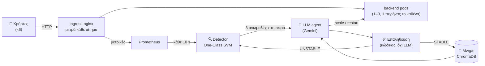
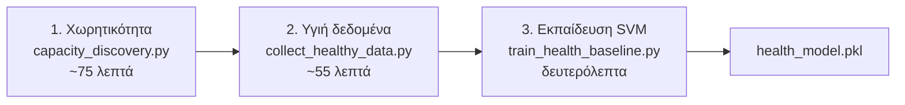
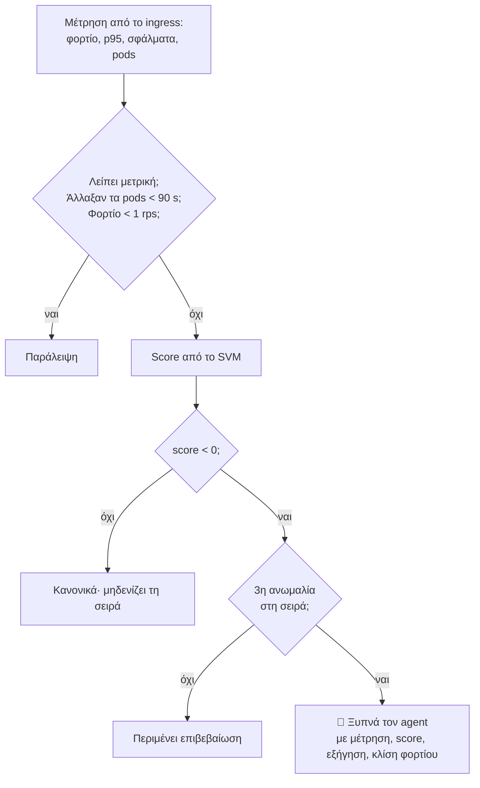
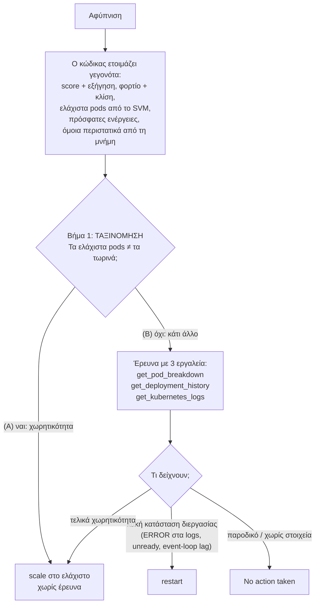
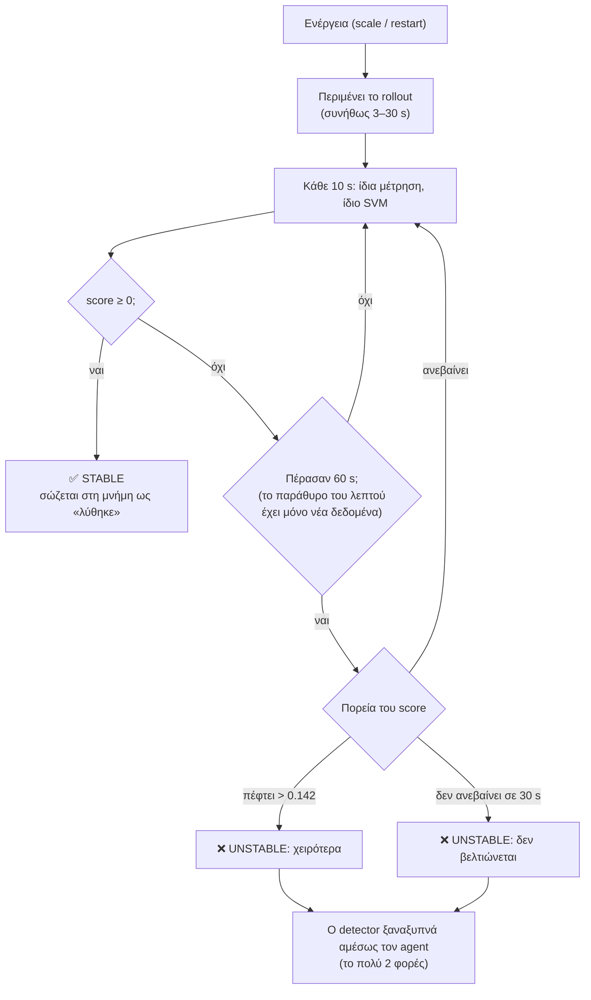
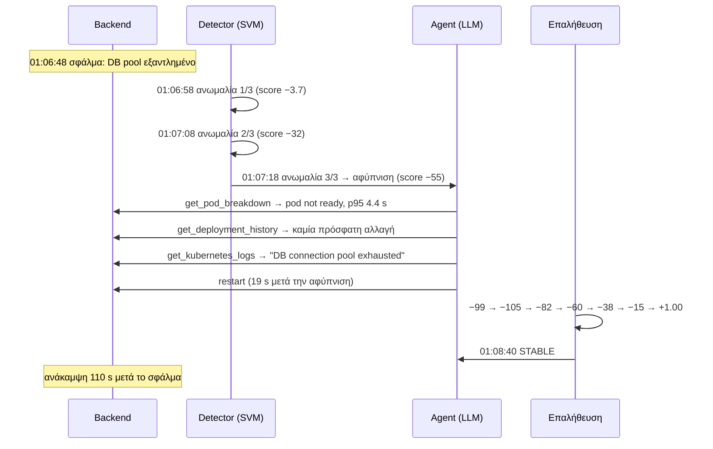
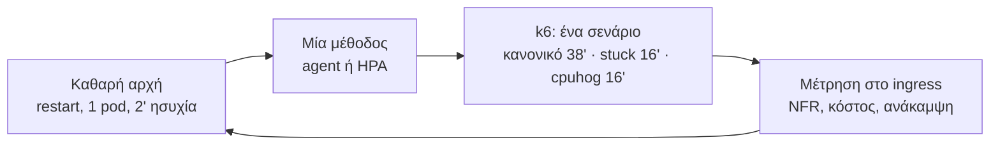

# Ένας LLM agent που κρατά μια υπηρεσία Kubernetes μέσα στις απαιτήσεις της

*Παρουσίαση για κάποιον που βλέπει το σύστημα πρώτη φορά. Κατάσταση: 31/10/2026, agent v11. Τα παραδείγματα και τα
αποτελέσματα είναι από την καμπάνια του v11 (`campaign-2026-10-28`).*

---

## 1. Η ιδέα σε μία εικόνα



- **Το SVM αποφασίζει *πότε*** κάτι δεν πάει καλά. Είναι φθηνό, γρήγορο και ντετερμινιστικό.
- **Το LLM αποφασίζει *τι*** να γίνει. Ερευνά με εργαλεία και κάνει μία ενέργεια.
- **Ο κώδικας ελέγχει *αν πέτυχε*.** Δεν εμπιστευόμαστε ποτέ το κείμενο του LLM.

**Η σύγκριση** γίνεται με τον εγγενή μηχανισμό του Kubernetes, το **HPA**, που κλιμακώνει με βάση την CPU (στόχος 60%).

---

## 2. Τι σημαίνει «σωστή λειτουργία»: οι NFR

| Απαίτηση (NFR) | Όριο | Πού μετριέται |
|---|---|---|
| Χρόνος απόκρισης | **p95 < 0.35 s** | στο ingress, όπως τη βλέπει ο χρήστης |
| Σφάλματα (5xx) | **< 1%** | στο ingress |
| Κόστος | **το πολύ 3 pods** | `MAX_REPLICAS` |
| Ασφαλές επίπεδο (περιθώριο) | p95 ≤ 0.25 s, σφάλματα ≤ 0.1% | ορίζει τη χωρητικότητα και τα «υγιή» δεδομένα |

Όλα αυτά ορίζονται **σε ένα σημείο**, στο `3-ai-agent/nfr_metrics.py`.

---

## 3. Πριν από την εκτέλεση: τι μαθαίνει το σύστημα (offline, μία φορά)



**1. Πόσο φορτίο αντέχει κάθε αριθμός pods.** Σκαλοπάτια σταθερού φορτίου, με τη μίξη αιτημάτων των χρηστών.

| Pods | Ασφαλές (p95 ≤ 0.25 s) | Σπάει η NFR (0.35 s) |
|---|---|---|
| 1 | 95 rps | 100 rps |
| 2 | 165 rps | 195 rps |
| 3 | 255 rps | 270 rps |

**2. Πώς μοιάζει το «υγιές».** Για κάθε αριθμό pods, μια ράμπα φορτίου πάνω και κάτω μέσα στο ασφαλές. Βγήκαν 188
μετρήσεις, από τις οποίες κρατήθηκαν 181, όσες ήταν μέσα στο ασφαλές επίπεδο.

**3. Το μοντέλο:** ένα One-Class SVM, εκπαιδευμένο μόνο σε υγιείς μετρήσεις (novelty detection).

---

## 4. Το μοντέλο υγείας (One-Class SVM)

### 4.1 Τι βλέπει: 4 αριθμούς, σε μονάδες των NFR

| Είσοδος | Μονάδα | Γιατί έτσι |
|---|---|---|
| φορτίο | ln(rps) | το «+20%» είναι ίδια απόσταση σε κάθε φορτίο |
| p95 | **0 στα 0.25 s, 1 στα 0.35 s** | κάτω από το ασφαλές όλα μετρούν ίδια: πιο γρήγορο = ποτέ χειρότερο |
| σφάλματα | **0 στο 0.1%, 1 στο 1%** | ίδιος ορισμός με το latency |
| pods | χωριστή «νησίδα» για κάθε αριθμό | 2 pods με λίγο φορτίο ≠ 1 pod |

Δεν υπάρχουν ρυθμιζόμενα βάρη. Η μόνη επιλογή είναι το γ (= 0.5), και τη διαλέγουν 40 δοκιμές που λένε π.χ. «p95 0.35 s
πρέπει να είναι ανωμαλία σε κάθε φορτίο και αριθμό pods».

### 4.2 Τι έμαθε: μια υγιή ζώνη φορτίου για κάθε αριθμό pods

```
φορτίο (rps) →  0        50       100      150      200      250
1 pod           [■■■■■■■■■■■■■■■■]  3.9 – 87
2 pods                       [■■■■■■■■■■■■■■■■■■]  73 – 162
3 pods                                [■■■■■■■■■■■■■■■■■■■■■■■■]  124 – 252
                                ↑ οι ζώνες επικαλύπτονται: έτσι δεν γίνεται «πήγαινε-έλα»
```

- **Έξω από τη ζώνη = ανωμαλία, ακόμα και με καλό latency.** Πάνω από τη ζώνη σημαίνει ότι έρχεται υπερφόρτωση, κάτω από
  τη ζώνη ότι πληρώνουμε άσκοπα pods.
- **Latency ή σφάλματα πάνω από το ασφαλές = ανωμαλία, σε οποιοδήποτε φορτίο.** Είναι πρόβλημα που δεν εξηγείται από το
  φορτίο.

### 4.3 Το score: πόσο μακριά από το υγιές

- **0 έως 1** = υγιές (1 = τυπικό).
- **Αρνητικό** = η απόσταση από την υγιή περιοχή. Δεν «κολλάει», άρα φαίνεται η πορεία.

Παράδειγμα με 1 pod στα 57 rps:

| p95 | ≤ 0.25 s | 0.28 s | 0.30 s | **0.35 s (NFR)** | 0.50 s | 1.0 s | 2.0 s |
|---|---|---|---|---|---|---|---|
| score | **+1.00** | −0.05 | −0.43 | **−0.94** | −2.0 | −4.1 | −6.2 |

| Σφάλμα | Τυπικό score |
|---|---|
| stuck (εξάντληση DB, 100% σφάλματα) | ≈ −111 |
| cpuhog (μπλοκαρισμένη CPU, p95 ~1.8 s) | ≈ −6 |
| υπερφόρτωση 1 pod (96 rps) | ≈ −0.8 |

---

## 5. Ο βρόχος του detector (κάθε 10 s)



**Γιατί 3 στη σειρά:** σε replay 3 καμπανιών, με 1 στη σειρά ο agent θα ξυπνούσε **46** φορές χωρίς λόγο, ενώ με 3 μόνο
**1**. Το κόστος είναι περίπου 30 s σε ένα σφάλμα.

---

## 6. Ο agent: πώς αποφασίζει



**Φραγμοί σε κώδικα**, όχι στο prompt. Ο καθένας μπήκε επειδή το LLM παρέβη τη σχετική οδηγία σε πραγματικό run:
- 1–3 pods, το πολύ ±2 ανά κίνηση, cooldown 30 s για scale και 60 s για restart·
- όχι ενέργεια στο ίδιο βήμα με μια παρατήρηση·
- όχι «το έκανα» χωρίς πραγματική κλήση εργαλείου·
- όχι restart πριν τρέξουν και τα 3 εργαλεία παρατήρησης.

---

## 7. Μετά την απόφαση: πώς ελέγχουμε ότι ήταν σωστή



**Τρία επίπεδα ελέγχου:**

| Επίπεδο | Ποιος | Τι κοιτά |
|---|---|---|
| 1. Αμέσως | κώδικας (`judge_trajectory`) | την πορεία του score μετά την ενέργεια → STABLE / UNSTABLE |
| 2. Μετά το run | `evaluate_run.py`, χωρίς το μοντέλο | δευτερόλεπτα έξω από τις NFR, ανάκαμψη, σωστός αριθμός pods |
| 3. Στην καμπάνια | `campaign_report.py` | «σωστή ενέργεια στην πρώτη αφύπνιση», με κριτήριο ορισμένο από πριν |

---

## 8. Ένα πραγματικό περιστατικό βήμα-βήμα (stuck, 28/10/2026)

**Σενάριο:** 1 pod, σταθερά 57 rps. Στις 01:06:48 το pool της βάσης «κολλάει»: κάθε αίτημα περιμένει 3 s και αποτυγχάνει.



| Ώρα | Τι μετρήθηκε στο ingress | Score | Τι έγινε |
|---|---|---|---|
| 01:06:37 | 57 rps, p95 0.12 s, 0% σφάλματα | +1.00 | κανονικά |
| 01:06:48 | — | — | **σφάλμα** (stuck) |
| 01:06:58 | p95 0.17 s, 3.4% σφάλματα | −3.7 | ανωμαλία 1/3 |
| 01:07:08 | p95 4.57 s, 28% σφάλματα | −32.2 | ανωμαλία 2/3 |
| 01:07:18 | p95 4.59 s, 49% σφάλματα, 0 έτοιμα pods | −55.4 | **αφύπνιση** |
| 01:07:18–37 | | | agent: 3 εργαλεία → **restart** (6 κλήσεις LLM, 19 s) |
| +0 → +60 s | σφάλματα 89% → 94% → 74% → 54% → 34% → 14% → **0%** | −99 → **+1.00** | **STABLE** |

**Το ίδιο σενάριο με το HPA:** η CPU πέφτει (το pod δεν δουλεύει) και το HPA δεν κάνει τίποτα. Το liveness probe
περνά, οπότε **δεν ανακάμπτει ποτέ**: 74% αποτυχημένα αιτήματα σε όλο το run.

---

## 9. Ένα run κανονικού φορτίου (28/10/2026, 06:31, 38 λεπτά)

Το φορτίο ανεβαίνει από 43 σε 210 rps και ξαναπέφτει, οπότε χρειάζονται 1 → 2 → 3 → 2 → 1 pods.

```
λεπτό:   0 ─────── 8:11 ─────────── 15:42 ──────────── 25:09 ────────── 31:56 ──── 38
pods:    1  ───────▶ 2  ────────────▶ 3  ──────────────▶ 2  ────────────▶ 1
                 ↑ 96 rps         ↑ 170 rps          ↓ 114 rps        ↓ 67 rps
              πάνω από 87      πάνω από 162       κάτω από 124      κάτω από 73
              (όριο 1 pod)     (όριο 2 pods)      (σπατάλη 3 pods)  (σπατάλη 2 pods)
```

| Αφύπνιση | Κατάσταση | Score | Μνήμη | Ενέργεια | Χρόνος agent | Επαλήθευση |
|---|---|---|---|---|---|---|
| +8:11 | 1 pod, 96 rps, p95 0.32 s | −0.81 | όμοιο: «1→2, STABLE» | **scale 1→2** | 7.0 s | −0.80 → −0.74 → −0.69 → −0.59 → **+1.00** |
| +15:42 | 2 pods, 170 rps, p95 0.28 s | −0.39 | όμοιο: «2→3, STABLE» | **scale 2→3** | 4.4 s | −0.49 → −0.34 → **+0.06** |
| +25:09 | 3 pods, 114 rps, p95 0.08 s | −0.22 | όμοιο: «3→2, STABLE» | **scale 3→2** | 5.8 s | −0.22 → **+1.00** |
| +31:56 | 2 pods, 67 rps, p95 0.07 s | −0.27 | όμοιο: «2→1, STABLE» | **scale 2→1** | 4.3 s | −0.27 → **+1.00** |

**Αποτέλεσμα του run:** **0 s** έξω από τις NFR, **71.3 replica-min** κόστος (HPA: 75.2–75.8), σωστός αριθμός pods το
**86.7%** του χρόνου (HPA: ~80%).

---

## 10. Πώς μετράμε: η καμπάνια



- **Αριθμός runs:** 4 (v10) ή 6 (v11) για κάθε σενάριο και μέθοδο. Agent και HPA εναλλάξ, ώστε να βρίσκουν τις ίδιες
  συνθήκες.
- **Κανόνες εγκυρότητας:**
  - το laptop πάντα στην πρίζα· ένα run σε μπαταρία είναι άκυρο και επαναλαμβάνεται·
  - ο agent τρέχει μόνο όταν το LLM απαντά·
  - ο κώδικας ελέγχεται με sha256.
- **Στατιστικά:** μόνο ακριβή τεστ (permutation, Fisher), χωρίς υποθέσεις κανονικότητας.

---

## 11. Αποτελέσματα

### Agent v11 έναντι HPA (καμπάνια 28/10· έγκυρα runs: HPA 6, agent 5 ανά σενάριο)

| | HPA | Agent v11 |
|---|---|---|
| **Stuck:** ανάκαμψη | ❌ 0/6 (74% αποτυχημένα αιτήματα) | ✅ **5/5**, σε 114 s κατά μέσο όρο |
| **Cpuhog:** ανάκαμψη | ❌ 0/6 (scale σε 2 pods, χωρίς όφελος) | ✅ **5/5**, σε 118 s |
| Σφάλματα μαζί | 0/12 | **10/10** (p = 1.5·10⁻⁶) |
| **Κανονικό:** κόστος | 76.0 replica-min | **72.1** (−5.1%, p = 0.002) |
| **Κανονικό:** σωστά pods | 78.8% | **83.9%** |
| **Κανονικό:** χρόνος έξω από τις NFR | **0 s** | 60 s (110 / 0 / 70 / 70 / 50) |

- **Ο agent:** 30/30 ενέργειες σωστές στην πρώτη αφύπνιση και επαληθευμένες STABLE, 0 ψευδείς αφυπνίσεις.
- **Η παραβίαση στο κανονικό φορτίο ακολουθεί κυρίως τον χρόνο του LLM:** με απάντηση σε 7 s ήταν 0 s, με 67–80 s ήταν
  50–110 s.
- **Η καμπάνια σταμάτησε στα 34 / 36 runs:** το Gemini ήταν εκτός 3 ώρες. Ένα run σε μπαταρία εξαιρέθηκε.

**Προηγούμενη έκδοση (v10, 26–27/10, 4 + 4 runs):** σφάλματα 8/8 έναντι 0/8, κόστος 72.3 έναντι 76.1, παραβίαση 82.5 s
έναντι 0 s, 24/24 ενέργειες σωστές.

---

## 12. Τι λέμε τίμια (όρια)

1. **Εξάρτηση από τον πάροχο του LLM:** ο χρόνος του ορίζει την παραβίαση στο κανονικό φορτίο.
2. **Το UNSTABLE και το ξαναξύπνημα δεν έχουν δοκιμαστεί ζωντανά**, γιατί όλες οι ενέργειες πέτυχαν. Προγραμματισμένο τεστ:
   φορτίο πάνω από το ταβάνι των 3 pods.
3. **Κάτω από τα 0.25 s το μοντέλο δεν βλέπει διαφορές latency.** Είναι η τιμή του «πιο γρήγορο = ποτέ χειρότερο».
4. **1 pod με λιγότερα από 3.9 rps** είναι έξω από τα δεδομένα. Βρέθηκε στις 28/10 και θα διορθωθεί μετά την καμπάνια.
5. **Ένα μηχάνημα, 2 τύποι σφαλμάτων, μικρό n.**

## 13. Πού βρίσκεται το καθένα

| Θέλεις… | Αρχείο |
|---|---|
| όλη την εικόνα | `thesis_notes/system_overview.md` |
| κάθε απόφαση με τα στοιχεία της | `thesis_notes/design_decisions.md` (Α24–Α30) |
| θεωρία → κώδικας | `thesis_notes/study_guide.md` |
| ερωτήσεις εξεταστών | `thesis_notes/defense_qa.md` |
| τον κώδικα | `3-ai-agent/` (detector, agent, εργαλεία, μοντέλο), `5-ml-training/` (εκπαίδευση), `4-load-testing/` (πειράματα) |
