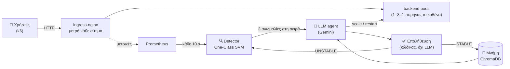
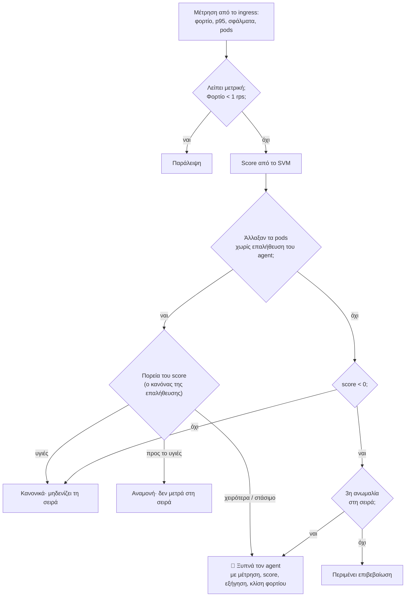
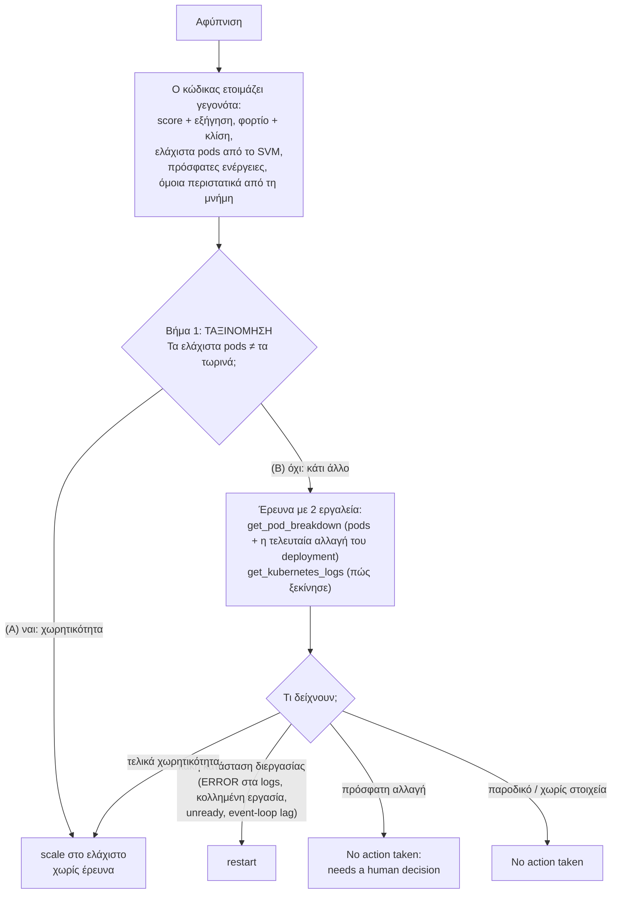
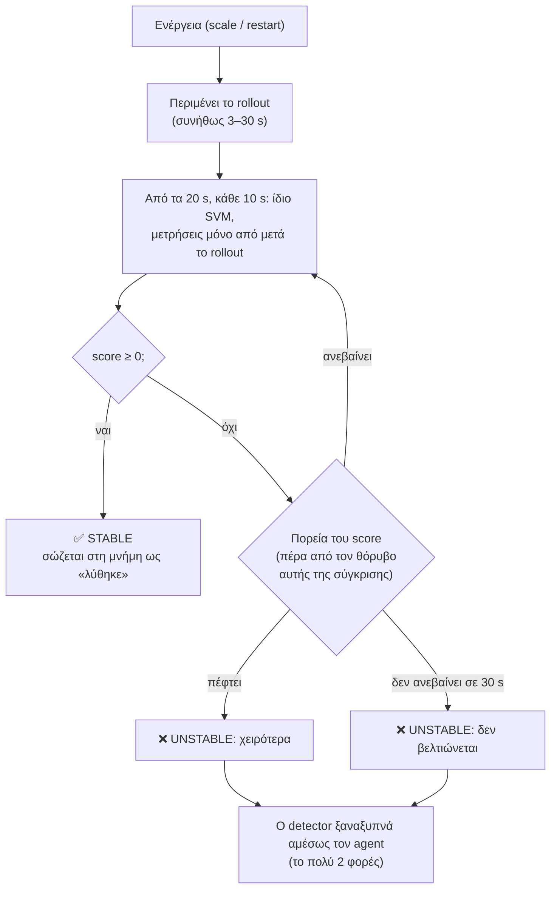
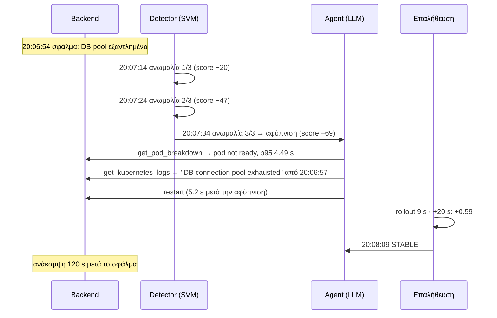
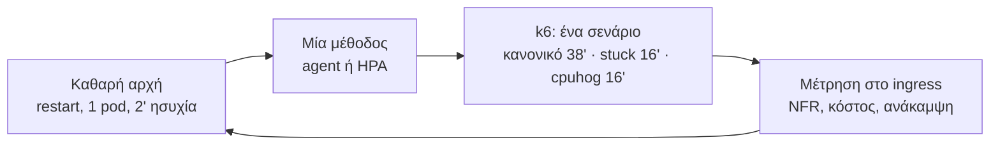

# Ένας LLM agent που κρατά μια υπηρεσία Kubernetes μέσα στις απαιτήσεις της

*Παρουσίαση για κάποιον που βλέπει το σύστημα πρώτη φορά. Κατάσταση: 9/11/2026, agent v14 (το τελικό prompt και η έρευνα
με δεδομένα και logs, Α33, Α34· ο detector του v13, Α32· το μοντέλο υγείας του v12, Α31). Τα παραδείγματα και τα
αποτελέσματα είναι από την καμπάνια του v14 (`campaign-v14-2026-11-08`).*

---

## 1. Η ιδέα σε μία εικόνα



- **Το SVM αποφασίζει *πότε*** κάτι δεν πάει καλά. Είναι φθηνό, γρήγορο και ντετερμινιστικό.
- **Το LLM αποφασίζει *τι*** να γίνει. Ερευνά με εργαλεία και κάνει μία ενέργεια.
- **Ο κώδικας ελέγχει *αν πέτυχε*.** Δεν εμπιστευόμαστε ποτέ το κείμενο του LLM.

**Η σύγκριση** γίνεται με τον εγγενή μηχανισμό του Kubernetes, το **HPA**, που κλιμακώνει με βάση την CPU (στόχος 60%).

---

## 2. Τι σημαίνει «σωστή λειτουργία»: οι NFR

| Απαίτηση (NFR) | Όριο | Πού μετριέται |
|---|---|---|
| Χρόνος απόκρισης | **p95 < 0.35 s** | στο ingress, όπως τη βλέπει ο χρήστης |
| Σφάλματα (5xx) | **< 1%** | στο ingress |
| Κόστος | **το πολύ 3 pods** | `MAX_REPLICAS` |
| Ασφαλές επίπεδο (περιθώριο) | p95 ≤ 0.25 s, σφάλματα ≤ 0.1% | ορίζει τη χωρητικότητα και τα «υγιή» δεδομένα |

Όλα αυτά ορίζονται **σε ένα σημείο**, στο `3-ai-agent/nfr_metrics.py`.

---

## 3. Πριν από την εκτέλεση: τι μαθαίνει το σύστημα (offline, μία φορά)


**1. Πόσο φορτίο αντέχει κάθε αριθμός pods.** Σκαλοπάτια σταθερού φορτίου, με τη μίξη αιτημάτων των χρηστών.

| Pods | Ασφαλές (p95 ≤ 0.25 s) | Σπάει η NFR (0.35 s) |
|---|---|---|
| 1 | 95 rps | 100 rps |
| 2 | 165 rps | 195 rps |
| 3 | 255 rps | 270 rps |

**2. Πώς μοιάζει το «υγιές».** Για κάθε αριθμό pods, μια ράμπα φορτίου πάνω και κάτω μέσα στο ασφαλές, και για το 1 pod
σκαλοπάτια σταθερού φορτίου στα 1–4 rps (αδράνεια). Βγήκαν 218 μετρήσεις, από τις οποίες κρατήθηκαν 210, όσες ήταν μέσα στο
ασφαλές επίπεδο.

**3. Το μοντέλο:** ένα One-Class SVM, εκπαιδευμένο μόνο σε υγιείς μετρήσεις (novelty detection).

---

## 4. Το μοντέλο υγείας (One-Class SVM)

### 4.1 Τι βλέπει: 4 αριθμούς, σε μονάδες των NFR

| Είσοδος | Μονάδα | Γιατί έτσι |
|---|---|---|
| φορτίο | ln(rps) | το «+20%» είναι ίδια απόσταση σε κάθε φορτίο |
| p95 | **0 στα 0.25 s, 1 στα 0.35 s** | κάτω από το ασφαλές όλα μετρούν ίδια: πιο γρήγορο = ποτέ χειρότερο |
| σφάλματα | **0 στο 0.1%, 1 στο 1%** | ίδιος ορισμός με το latency |
| pods | χωριστή «νησίδα» για κάθε αριθμό | 2 pods με λίγο φορτίο ≠ 1 pod |

Δεν υπάρχουν ρυθμιζόμενα βάρη. Η μόνη επιλογή είναι το γ (= 0.1). Το διαλέγουν 34 δοκιμές σε όλο το εύρος του φορτίου,
όχι σε λίγα σημεία, που λένε π.χ. «p95 0.35 s πρέπει να είναι ανωμαλία σε κάθε φορτίο και αριθμό pods» και «η υγιής ζώνη κάθε
αριθμού pods είναι ένα κομμάτι, χωρίς τρύπες». Μια τέτοια τρύπα, στα 18 rps με 1 pod, είχε το μοντέλο v11 (γ 0.5).

### 4.2 Τι έμαθε: μια υγιή ζώνη φορτίου για κάθε αριθμό pods

```
φορτίο (rps) →  0        50       100      150      200      250
1 pod          [■■■■■■■■■■■■■■■■■]  1 – 87
2 pods                       [■■■■■■■■■■■■■■■■■■]  73 – 162
3 pods                                [■■■■■■■■■■■■■■■■■■■■■■■■]  124 – 252
                                ↑ οι ζώνες επικαλύπτονται: έτσι δεν γίνεται «πήγαινε-έλα»
```

- **Έξω από τη ζώνη = ανωμαλία, ακόμα και με καλό latency.** Πάνω από τη ζώνη σημαίνει ότι έρχεται υπερφόρτωση, κάτω από
  τη ζώνη ότι πληρώνουμε άσκοπα pods.
- **Latency ή σφάλματα πάνω από το ασφαλές = ανωμαλία, σε οποιοδήποτε φορτίο.** Είναι πρόβλημα που δεν εξηγείται από το
  φορτίο.

### 4.3 Το score: πόσο μακριά από το υγιές

- **0 έως 1** = υγιές (1 = τυπικό).
- **Αρνητικό** = η απόσταση από την υγιή περιοχή. Δεν «κολλάει», άρα φαίνεται η πορεία.

Παράδειγμα με 1 pod στα 57 rps:

| p95 | ≤ 0.25 s | 0.28 s | 0.30 s | **0.35 s (NFR)** | 0.50 s | 1.0 s | 2.0 s |
|---|---|---|---|---|---|---|---|
| score | **+0.59** | +0.40 | +0.11 | **−0.80** | −2.0 | −4.1 | −6.2 |

Στα 57 rps το μοντέλο ανέχεται p95 ως 0.306 s πριν πει ανωμαλία· είναι η τιμή του γ 0.1, του μόνου χωρίς τρύπες (§12).

| Κατάσταση (στην αφύπνιση, καμπάνια του v14) | Score |
|---|---|
| stuck: εξάντληση DB, p95 4.58 s, 61.8% σφάλματα | −69 (≈ −111 με 100% σφάλματα) |
| cpuhog: μπλοκαρισμένο event loop, p95 1.38 s, 4% σφάλματα | −6.7 |
| υπερφόρτωση 1 pod: 96.6 rps, p95 0.32 s | −0.84 |

---

## 5. Ο βρόχος του detector (κάθε 10 s)



**Γιατί 3 στη σειρά:** σε replay 3 καμπανιών, με 1 στη σειρά ο agent θα ξυπνούσε **46** φορές χωρίς λόγο, ενώ με 3 μόνο
**1**. Το κόστος είναι περίπου 30 s σε ένα σφάλμα.

**Μετά από αλλαγή (v13, Α32, Α32.1):** καμία μέτρηση δεν παραλείπεται, και κάθε μέτρηση έχει μόνο δεδομένα από μετά την
αλλαγή: το παράθυρο ξεκινά από εκεί και μεγαλώνει ως το λεπτό. Αν την αλλαγή την έκανε ο agent, η επαλήθευσή του την έχει ήδη
ακολουθήσει ως το STABLE, και η επόμενη μέτρηση κρίνεται κανονικά. Αν την έκανε κάποιος άλλος (με το χέρι, ένα script), ο
detector την ακολουθεί με τον ίδιο κανόνα. Ο v12 περίμενε 90 s, που σε 1 από 86 ενέργειες έκρυψαν μια πραγματική παραβίαση.

---

## 6. Ο agent: πώς αποφασίζει



**Τι διαβάζει το LLM.** Ένα σταθερό system prompt, δικό μας (ρόλος, NFR, τι σηκώνει κάθε αριθμός pods, η διαδικασία πάνω, η
μορφή κάθε απάντησης: μία γραμμή «Thoughts:» και ένα μπλοκ Python με ένα εργαλείο), και σε κάθε αφύπνιση ένα μήνυμα μόνο με
το περιστατικό: η μέτρηση, τα γεγονότα, οι πρόσφατες ενέργειες, η μνήμη, και στο τέλος η εργασία (Α33).

**Τα logs δείχνουν πώς ξεκίνησε το πρόβλημα** (Α34): τα τελευταία 10 λεπτά κάθε pod, με τις προειδοποιήσεις και τα σφάλματα
ομαδοποιημένα ανά μήνυμα, την πρώτη και την τελευταία φορά τους, και τα σπάνια αιτήματα του παραθύρου. Το inject του σφάλματος
δεν αφήνει ίχνος στα logs, άρα ο agent βλέπει μόνο τα συμπτώματα.

**Φραγμοί σε κώδικα**, όχι στο prompt. Ο καθένας μπήκε επειδή το LLM παρέβη τη σχετική οδηγία σε πραγματικό run:
- 1–3 pods, το πολύ ±2 ανά κίνηση, cooldown 30 s για scale και 60 s για restart·
- όχι ενέργεια στο ίδιο βήμα με μια παρατήρηση·
- όχι «το έκανα» χωρίς πραγματική κλήση εργαλείου·
- όχι restart πριν τρέξουν και τα 2 εργαλεία παρατήρησης.

**Το LLM:** `gemini-3.1-flash-lite`. Κάθε κλήση κόβεται στα 60 s· σε σφάλμα ξαναδοκιμάζει μετά από 5, 15 και 30 s, και μετά
πάει στο εφεδρικό `gemini-2.5-flash`.

---

## 7. Μετά την απόφαση: πώς ελέγχουμε ότι ήταν σωστή



**Τρία επίπεδα ελέγχου:**

| Επίπεδο | Ποιος | Τι κοιτά |
|---|---|---|
| 1. Αμέσως | κώδικας (`judge_trajectory`) | την πορεία του score μετά την ενέργεια → STABLE / UNSTABLE |
| 2. Μετά το run | `evaluate_run.py`, χωρίς το μοντέλο | δευτερόλεπτα έξω από τις NFR, ανάκαμψη, σωστός αριθμός pods |
| 3. Στην καμπάνια | `campaign_report.py` | «σωστή ενέργεια στην πρώτη αφύπνιση», με κριτήριο ορισμένο από πριν |

---

## 8. Ένα πραγματικό περιστατικό βήμα-βήμα (stuck, 8/11/2026, καμπάνια του v14)

**Σενάριο:** 1 pod, σταθερά 57 rps. Στις 20:06:54 το pool της βάσης «κολλάει»: κάθε αίτημα περιμένει 3 s και αποτυγχάνει.



| Ώρα | Τι μετρήθηκε στο ingress (παράθυρο 1 λεπτού) | Score | Τι έγινε |
|---|---|---|---|
| 20:06:54 | 57 rps, p95 0.14 s, 0% σφάλματα | +0.59 | κανονικά· **σφάλμα** (stuck) |
| 20:07:14 | p95 4.34 s, 16.7% σφάλματα, 0 έτοιμα pods | −20.3 | ανωμαλία 1/3 |
| 20:07:24 | p95 4.58 s, 41.6% σφάλματα | −46.9 | ανωμαλία 2/3 |
| 20:07:34 | p95 4.58 s, 61.8% σφάλματα | −69.0 | **αφύπνιση** |
| 20:07:34–39 | | | agent: pods → logs → **restart** (4 κλήσεις LLM, 5.2 s) |
| 20:07:49 | | | το νέο pod έτοιμο (rollout 9 s) |
| 20:08:09 | μόνο δεδομένα από μετά το rollout: 57.5 rps, p95 0.12 s, 0% | **+0.59** | **STABLE** στα +20 s |
| 20:08:54 | το παράθυρο του λεπτού: σφάλματα 100% → 62% → 22% → **0%** | | οι NFR ξανά εντάξει: **ανάκαμψη 120 s** |

**Τι είδε στα logs** (η έξοδος του εργαλείου, συντομευμένη):
```
- ERROR x741, first 20:06:56, last 20:07:36 on GET /places/search 213, GET /places/:id 183, ...: Server error (5xx): 503
- ERROR x731, first 20:06:57, last 20:07:10 on GET /places/search 213, ...: DB connection pool exhausted:
  waited 3000ms for a free connection (0/10 idle since 2026-11-08T18:06:54.589Z)
Rare requests: none; every endpoint called in the window (14610 requests) is part of the steady traffic.
```
Η πρώτη γραμμή κάθε ομάδας λέει πότε άρχισε το πρόβλημα, και κανένα σπάνιο αίτημα δεν ήρθε πριν. Ο agent απάντησε: «Root
cause: The application's DB connection pool was exhausted, causing 503 errors and high latency for all incoming requests.
Action: Triggered a rolling restart …».

- **Η επαλήθευση** μετρά μόνο δεδομένα από μετά το rollout (v13), οπότε το STABLE ήρθε στα 20 s. Το παράθυρο του λεπτού στο
  ingress κράτησε τα αποτυχημένα αιτήματα από πριν για ακόμα ~45 s: γι' αυτό η «ανάκαμψη» της αξιολόγησης είναι 120 s.
- **Το ίδιο στο cpuhog** (21:12): τα logs έδειξαν `job "rebuild-search-index" started` στις 21:12:48 και μετά `still running
  after 10s … event loop blocked 600ms per iteration`· το `get_pod_breakdown` έδειξε event-loop lag p99 1.14 s (υγιές ~0.085,
  max 0.39). Restart σε 6.1 s, STABLE στα +20 s, ανάκαμψη 100 s.

**Το ίδιο σενάριο με το HPA:** η CPU πέφτει (το pod δεν δουλεύει) και το HPA δεν κάνει τίποτα. Το liveness probe
περνά, οπότε **δεν ανακάμπτει ποτέ**: 74% αποτυχημένα αιτήματα σε όλο το run.

---

## 9. Ένα run κανονικού φορτίου (8/11/2026, 14:45, 38 λεπτά, καμπάνια του v14)

Το φορτίο ανεβαίνει από 43 σε 210 rps και ξαναπέφτει, οπότε χρειάζονται 1 → 2 → 3 → 2 → 1 pods.

```
λεπτό:   0 ─────── 8:11 ─────────── 15:47 ──────────── 25:16 ────────── 32:01 ──── 38
pods:    1  ───────▶ 2  ────────────▶ 3  ──────────────▶ 2  ────────────▶ 1
                 ↑ 97 rps         ↑ 172 rps          ↓ 112 rps        ↓ 68 rps
              πάνω από 87.3   πάνω από 162.1      κάτω από 123.3    κάτω από 73.5
              (όριο 1 pod)    (όριο 2 pods)       (σπατάλη 3 pods)  (σπατάλη 2 pods)
```

| Αφύπνιση | Κατάσταση | Score | Ενέργεια | Χρόνος agent | Επαλήθευση |
|---|---|---|---|---|---|
| +8:11 | 1 pod, 96.6 rps, p95 0.32 s | −0.84 | **scale 1→2** | 3.7 s | **+1.00** στα +20 s |
| +15:47 | 2 pods, 172.2 rps, p95 0.26 s | −0.27 | **scale 2→3** | 47.5 s | **+1.00** στα +20 s |
| +25:16 | 3 pods, 112.3 rps, p95 0.08 s | −0.27 | **scale 3→2** | 2.8 s | **+1.00** στα +20 s |
| +32:01 | 2 pods, 67.7 rps, p95 0.08 s | −0.26 | **scale 2→1** | 2.7 s | **+0.64** στα +20 s |

**Αποτέλεσμα του run:** **0 s** έξω από τις NFR, **71.5 replica-min** κόστος (HPA στο ίδιο ζεύγος: 78.0), σωστός αριθμός
pods το **88.5%** του χρόνου (HPA: 73.9%).

- Ήταν το πρώτο run της καμπάνιας, με άδεια μνήμη. Στα επόμενα η μνήμη βρήκε όμοιο περιστατικό με την ίδια ενέργεια σε 12 από
  τις 12 αφυπνίσεις.
- Τα 47.5 s στο 2→3 ήταν μία αργή κλήση του Gemini (κάτω από το όριο των 60 s, χωρίς επανάληψη).
- **Σε δύο άλλα runs** το 1→2 έδωσε παραβίαση 60 και 30 s: ο detector ξυπνά πάντα στα ~90–97 rps, αλλά το p95 του ενός pod
  τη στιγμή της αλλαγής κυμαίνεται 0.30–0.39 s, και μετά το scale το παράθυρο του λεπτού κρατά τα αιτήματα της ουράς για
  20–40 s (§11).

---

## 10. Πώς μετράμε: η καμπάνια



- **Αριθμός runs:** 4 (v10, v12, v14) ή 6 (v11) για κάθε σενάριο και μέθοδο. Agent και HPA εναλλάξ, ώστε να βρίσκουν τις
  ίδιες συνθήκες. Η μνήμη ανοιχτή στο κανονικό φορτίο, κλειστή στα σφάλματα, άδεια στην αρχή.
- **Κανόνες εγκυρότητας:**
  - το laptop πάντα στην πρίζα· ένα run σε μπαταρία είναι άκυρο και επαναλαμβάνεται·
  - ο agent τρέχει μόνο όταν το LLM απαντά·
  - ο κώδικας ελέγχεται με sha256.
- **Στατιστικά:** μόνο ακριβή τεστ (permutation, Fisher), χωρίς υποθέσεις κανονικότητας.

---

## 11. Αποτελέσματα

### Agent v14 έναντι HPA (καμπάνια 8–9/11· 4 + 4 runs ανά σενάριο· ένα run σε μπαταρία επαναλήφθηκε)

| | HPA | Agent v14 |
|---|---|---|
| **Stuck:** ανάκαμψη | ❌ 0/4 (74% αποτυχημένα αιτήματα) | ✅ **4/4**, σε 125 s κατά μέσο όρο (110–150) |
| **Cpuhog:** ανάκαμψη | ❌ 0/4 (scale σε 2 pods, χωρίς όφελος) | ✅ **4/4**, σε 102 s (100–110) |
| Σφάλματα μαζί | 0/8 | **8/8** (p = 0.00008) |
| **Κανονικό:** κόστος | 77.4 replica-min | **71.6** (−7.5%, p = 0.014) |
| **Κανονικό:** σωστά pods | 75.0% | **88.2%** |
| **Κανονικό:** χρόνος έξω από τις NFR | 47.5 s (0 / 50 / 40 / 100) | 27.5 s (0 / 80 / 0 / 30), διαφορά όχι σημαντική (p = 0.24) |

- **Ο agent:** 24 ενέργειες, όλες σωστές στην πρώτη αφύπνιση και όλες STABLE στα 20 s. Καμία επανάληψη κλήσης, κανένα
  εφεδρικό μοντέλο, χρόνος agent διάμεσος 4.5 s. Στα 8 σφάλματα έγραψε τη σωστή αιτία, από τα logs.
- **Η μνήμη** βρήκε όμοιο περιστατικό με την ίδια ενέργεια σε 12 / 12 αφυπνίσεις κανονικού φορτίου, από το 2ο run και μετά.
- **Η παραβίαση του agent είναι μόνο στα scale-up** (90 s στο 1→2, 20 s στο 2→3): ξυπνά στο όριο της ζώνης, όταν το pod έχει
  ήδη ουρά, και το παράθυρο του λεπτού την κρατά για 20–40 s μετά. Το HPA κλιμακώνει νωρίτερα, στα 70–80 rps.
- **Η παραβίαση του HPA είναι σύντομα παγώματα των pods:** το p95 μέσα στα pods έμεινε 0.07–0.09 s, ενώ το event-loop lag πήδηξε
  για ~1 s. Είναι το μηχάνημα, όχι το HPA· στα runs του agent δεν έτυχε κανένα.
- **Σε όλες τις καμπάνιες της φάσης 2:** σφάλματα agent 41/42, HPA 0/44.

**Προηγούμενη έκδοση (v12, 1–2/11, 4 + 4):** σφάλματα 8/8 έναντι 0/8 (stuck 138 s, cpuhog 118 s), κόστος 72.2 έναντι 76.4,
παραβίαση 72.5 s έναντι 27.5 s, 25 ενέργειες STABLE (μία περιττή).

---

## 12. Τι λέμε τίμια (όρια)

1. **Εξάρτηση από τον πάροχο του LLM:** κάθε κλήση κόβεται στα 60 s, αλλά δύο αργές κλήσεις κάτω από το όριο (37 και 42 s)
   έκαναν ένα stuck 150 s αντί για ~120. Δεν υπάρχει degraded mode.
2. **Το UNSTABLE και το ξαναξύπνημα δεν έχουν φανεί σε καμπάνια**, γιατί όλες οι ενέργειες πέτυχαν. Δοκιμάστηκαν ζωντανά
   στο τεστ UNSTABLE του v12 (φορτίο πάνω από το ταβάνι των 3 pods): 3 UNSTABLE, 2 ξαναξυπνήματα, μετά το όριο.
   - Η επαλήθευση κρίνει την κατάσταση, όχι αν την έφερε η ενέργεια (στον v12 ένα περιττό restart βγήκε STABLE).
3. **Αντίδραση στο όριο:** ως ~60 s παραβίαση στο 1→2, ακόμα και με γρήγορο LLM. Είναι το κόστος του σχεδιασμού χωρίς
   πρόβλεψη.
4. **Κάτω από τα 0.25 s το μοντέλο δεν βλέπει διαφορές latency.** Είναι η τιμή του «πιο γρήγορο = ποτέ χειρότερο».
5. **Το γ 0.1 ανέχεται περισσότερο latency** στη μέση της ζώνης του 1 pod (ως ~0.33 s) πριν πει ανωμαλία. Είναι η τιμή του
   «καμία τρύπα».
6. **Ένα μηχάνημα, 2 γνωστοί τύποι σφαλμάτων, μικρό n.** Τα παγώματα των pods επηρεάζουν και τις δύο μεθόδους, και το πώς
   απαντά ο v14 σε ένα τέτοιο επεισόδιο δεν φάνηκε στην καμπάνια του.

## 13. Πού βρίσκεται το καθένα

| Θέλεις… | Αρχείο |
|---|---|
| όλη την εικόνα | `thesis_notes/system_overview.md` |
| κάθε απόφαση με τα στοιχεία της | `thesis_notes/design_decisions.md` (Α24–Α34) |
| θεωρία → κώδικας | `thesis_notes/study_guide.md` |
| ερωτήσεις εξεταστών | `thesis_notes/defense_qa.md` |
| τον κώδικα | `3-ai-agent/` (detector, agent, εργαλεία, μοντέλο), `5-ml-training/` (εκπαίδευση), `4-load-testing/` (πειράματα) |
