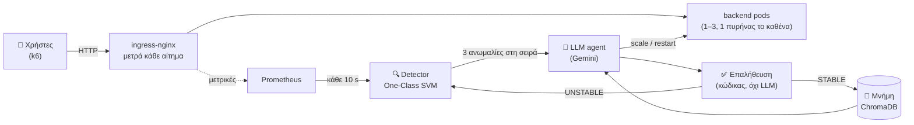
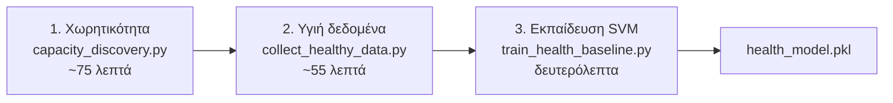
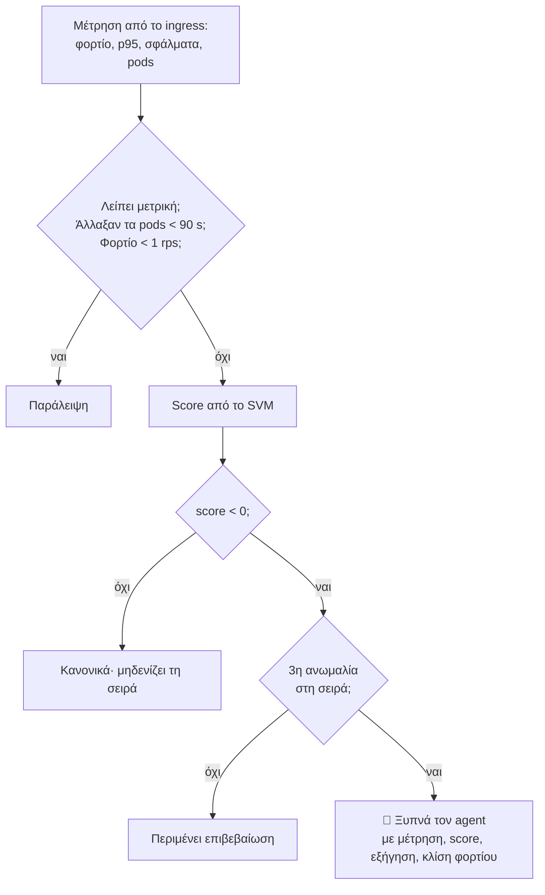
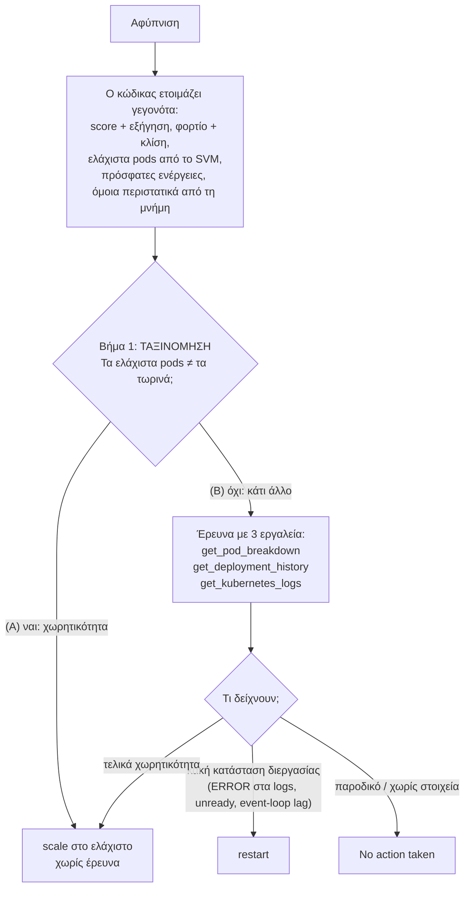
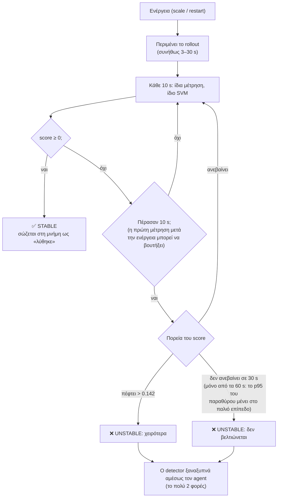
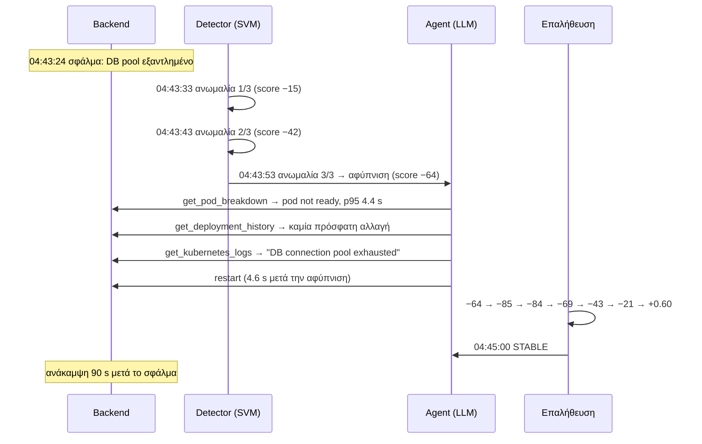
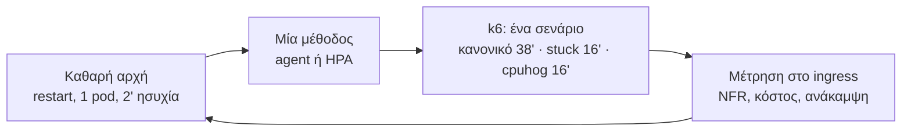

# Ένας LLM agent που κρατά μια υπηρεσία Kubernetes μέσα στις απαιτήσεις της

*Παρουσίαση για κάποιον που βλέπει το σύστημα πρώτη φορά. Κατάσταση: 2/11/2026, agent v12 (το μοντέλο ελεγμένο με
probes-εύρη, το 1 pod σε αδράνεια, η επαλήθευση από τα 10 s). Τα παραδείγματα και τα αποτελέσματα είναι από την καμπάνια
του v12 (`campaign-2026-11-01`).*

---

## 1. Η ιδέα σε μία εικόνα



- **Το SVM αποφασίζει *πότε*** κάτι δεν πάει καλά. Είναι φθηνό, γρήγορο και ντετερμινιστικό.
- **Το LLM αποφασίζει *τι*** να γίνει. Ερευνά με εργαλεία και κάνει μία ενέργεια.
- **Ο κώδικας ελέγχει *αν πέτυχε*.** Δεν εμπιστευόμαστε ποτέ το κείμενο του LLM.

**Η σύγκριση** γίνεται με τον εγγενή μηχανισμό του Kubernetes, το **HPA**, που κλιμακώνει με βάση την CPU (στόχος 60%).

---

## 2. Τι σημαίνει «σωστή λειτουργία»: οι NFR

| Απαίτηση (NFR) | Όριο | Πού μετριέται |
|---|---|---|
| Χρόνος απόκρισης | **p95 < 0.35 s** | στο ingress, όπως τη βλέπει ο χρήστης |
| Σφάλματα (5xx) | **< 1%** | στο ingress |
| Κόστος | **το πολύ 3 pods** | `MAX_REPLICAS` |
| Ασφαλές επίπεδο (περιθώριο) | p95 ≤ 0.25 s, σφάλματα ≤ 0.1% | ορίζει τη χωρητικότητα και τα «υγιή» δεδομένα |

Όλα αυτά ορίζονται **σε ένα σημείο**, στο `3-ai-agent/nfr_metrics.py`.

---

## 3. Πριν από την εκτέλεση: τι μαθαίνει το σύστημα (offline, μία φορά)



**1. Πόσο φορτίο αντέχει κάθε αριθμός pods.** Σκαλοπάτια σταθερού φορτίου, με τη μίξη αιτημάτων των χρηστών.

| Pods | Ασφαλές (p95 ≤ 0.25 s) | Σπάει η NFR (0.35 s) |
|---|---|---|
| 1 | 95 rps | 100 rps |
| 2 | 165 rps | 195 rps |
| 3 | 255 rps | 270 rps |

**2. Πώς μοιάζει το «υγιές».** Για κάθε αριθμό pods, μια ράμπα φορτίου πάνω και κάτω μέσα στο ασφαλές. Βγήκαν 188
μετρήσεις, από τις οποίες κρατήθηκαν 181, όσες ήταν μέσα στο ασφαλές επίπεδο.

**3. Το μοντέλο:** ένα One-Class SVM, εκπαιδευμένο μόνο σε υγιείς μετρήσεις (novelty detection).

---

## 4. Το μοντέλο υγείας (One-Class SVM)

### 4.1 Τι βλέπει: 4 αριθμούς, σε μονάδες των NFR

| Είσοδος | Μονάδα | Γιατί έτσι |
|---|---|---|
| φορτίο | ln(rps) | το «+20%» είναι ίδια απόσταση σε κάθε φορτίο |
| p95 | **0 στα 0.25 s, 1 στα 0.35 s** | κάτω από το ασφαλές όλα μετρούν ίδια: πιο γρήγορο = ποτέ χειρότερο |
| σφάλματα | **0 στο 0.1%, 1 στο 1%** | ίδιος ορισμός με το latency |
| pods | χωριστή «νησίδα» για κάθε αριθμό | 2 pods με λίγο φορτίο ≠ 1 pod |

Δεν υπάρχουν ρυθμιζόμενα βάρη. Η μόνη επιλογή είναι το γ (= 0.1). Το διαλέγουν 34 δοκιμές σε όλο το εύρος του φορτίου,
όχι σε λίγα σημεία, που λένε π.χ. «p95 0.35 s πρέπει να είναι ανωμαλία σε κάθε φορτίο και αριθμό pods» και «η υγιής ζώνη κάθε
αριθμού pods είναι ένα κομμάτι, χωρίς τρύπες». Μια τέτοια τρύπα, στα 18 rps με 1 pod, είχε το μοντέλο v11 (γ 0.5).

### 4.2 Τι έμαθε: μια υγιή ζώνη φορτίου για κάθε αριθμό pods

```
φορτίο (rps) →  0        50       100      150      200      250
1 pod          [■■■■■■■■■■■■■■■■■]  1 – 87
2 pods                       [■■■■■■■■■■■■■■■■■■]  73 – 162
3 pods                                [■■■■■■■■■■■■■■■■■■■■■■■■]  124 – 252
                                ↑ οι ζώνες επικαλύπτονται: έτσι δεν γίνεται «πήγαινε-έλα»
```

- **Έξω από τη ζώνη = ανωμαλία, ακόμα και με καλό latency.** Πάνω από τη ζώνη σημαίνει ότι έρχεται υπερφόρτωση, κάτω από
  τη ζώνη ότι πληρώνουμε άσκοπα pods.
- **Latency ή σφάλματα πάνω από το ασφαλές = ανωμαλία, σε οποιοδήποτε φορτίο.** Είναι πρόβλημα που δεν εξηγείται από το
  φορτίο.

### 4.3 Το score: πόσο μακριά από το υγιές

- **0 έως 1** = υγιές (1 = τυπικό).
- **Αρνητικό** = η απόσταση από την υγιή περιοχή. Δεν «κολλάει», άρα φαίνεται η πορεία.

Παράδειγμα με 1 pod στα 57 rps:

| p95 | ≤ 0.25 s | 0.28 s | 0.30 s | **0.35 s (NFR)** | 0.50 s | 1.0 s | 2.0 s |
|---|---|---|---|---|---|---|---|
| score | **+1.00** | −0.05 | −0.43 | **−0.94** | −2.0 | −4.1 | −6.2 |

| Σφάλμα | Τυπικό score |
|---|---|
| stuck (εξάντληση DB, 100% σφάλματα) | ≈ −111 |
| cpuhog (μπλοκαρισμένη CPU, p95 ~1.8 s) | ≈ −6 |
| υπερφόρτωση 1 pod (96 rps) | ≈ −0.8 |

---

## 5. Ο βρόχος του detector (κάθε 10 s)



**Γιατί 3 στη σειρά:** σε replay 3 καμπανιών, με 1 στη σειρά ο agent θα ξυπνούσε **46** φορές χωρίς λόγο, ενώ με 3 μόνο
**1**. Το κόστος είναι περίπου 30 s σε ένα σφάλμα.

---

## 6. Ο agent: πώς αποφασίζει



**Φραγμοί σε κώδικα**, όχι στο prompt. Ο καθένας μπήκε επειδή το LLM παρέβη τη σχετική οδηγία σε πραγματικό run:
- 1–3 pods, το πολύ ±2 ανά κίνηση, cooldown 30 s για scale και 60 s για restart·
- όχι ενέργεια στο ίδιο βήμα με μια παρατήρηση·
- όχι «το έκανα» χωρίς πραγματική κλήση εργαλείου·
- όχι restart πριν τρέξουν και τα 3 εργαλεία παρατήρησης.

---

## 7. Μετά την απόφαση: πώς ελέγχουμε ότι ήταν σωστή



**Τρία επίπεδα ελέγχου:**

| Επίπεδο | Ποιος | Τι κοιτά |
|---|---|---|
| 1. Αμέσως | κώδικας (`judge_trajectory`) | την πορεία του score μετά την ενέργεια → STABLE / UNSTABLE |
| 2. Μετά το run | `evaluate_run.py`, χωρίς το μοντέλο | δευτερόλεπτα έξω από τις NFR, ανάκαμψη, σωστός αριθμός pods |
| 3. Στην καμπάνια | `campaign_report.py` | «σωστή ενέργεια στην πρώτη αφύπνιση», με κριτήριο ορισμένο από πριν |

---

## 8. Ένα πραγματικό περιστατικό βήμα-βήμα (stuck, 2/11/2026)

**Σενάριο:** 1 pod, σταθερά 57 rps. Στις 04:43:24 το pool της βάσης «κολλάει»: κάθε αίτημα περιμένει 3 s και αποτυγχάνει.



| Ώρα | Τι μετρήθηκε στο ingress | Score | Τι έγινε |
|---|---|---|---|
| 04:43:23 | 57 rps, p95 0.12 s, 0% σφάλματα | +0.60 | κανονικά |
| 04:43:24 | — | — | **σφάλμα** (stuck) |
| 04:43:33 | p95 4.10 s, 11% σφάλματα | −15.1 | ανωμαλία 1/3 |
| 04:43:43 | p95 4.60 s, 37% σφάλματα, 0 έτοιμα pods | −41.6 | ανωμαλία 2/3 |
| 04:43:53 | p95 4.60 s, 57% σφάλματα, 0 έτοιμα pods | −63.6 | **αφύπνιση** |
| 04:43:53–57 | | | agent: 3 εργαλεία → **restart** (5 κλήσεις LLM, 4.6 s) |
| +0 → +60 s | σφάλματα 57% → 76% → 76% → 62% → 39% → 19% → **0%** | −64 → **+0.60** | **STABLE** |

- **Η πρώτη μέτρηση μετά το restart βούτηξε** (−64 → −85), όσο το παλιό pod έφευγε. Ο κανόνας κρίνει το «χειρότερα» από τα
  10 s και μετά (Α31.1), οπότε δεν την έκρινε αποτυχία.
- Το +0.60 είναι το τυπικό υγιές score του v12 για 1 pod στα 57 rps. Οτιδήποτε ≥ 0 είναι υγιές.

**Το ίδιο σενάριο με το HPA:** η CPU πέφτει (το pod δεν δουλεύει) και το HPA δεν κάνει τίποτα. Το liveness probe
περνά, οπότε **δεν ανακάμπτει ποτέ**: 74% αποτυχημένα αιτήματα σε όλο το run.

---

## 9. Ένα run κανονικού φορτίου (2/11/2026, 06:06, 38 λεπτά)

Το φορτίο ανεβαίνει από 43 σε 210 rps και ξαναπέφτει, οπότε χρειάζονται 1 → 2 → 3 → 2 → 1 pods.

```
λεπτό:   0 ─────── 7:20 ─────────── 15:44 ──────────── 25:09 ────────── 31:52 ──── 38
pods:    1  ───────▶ 2  ────────────▶ 3  ──────────────▶ 2  ────────────▶ 1
                 ↑ 80 rps         ↑ 172 rps          ↓ 113 rps        ↓ 68 rps
              p95 0.29 s και   πάνω από 162       κάτω από 123      κάτω από 73.5
              φορτίο ανεβαίνει (όριο 2 pods)      (σπατάλη 3 pods)  (σπατάλη 2 pods)
```

| Αφύπνιση | Κατάσταση | Score | Μνήμη | Ενέργεια | Χρόνος agent | Επαλήθευση |
|---|---|---|---|---|---|---|
| +7:20 | 1 pod, 80 rps, p95 0.29 s | −0.31 | όμοιο: «1→2, STABLE» | **scale 1→2** | 25.7 s | −0.20 → −0.58 → −0.52 → −0.19 → **+0.71** |
| +15:44 | 2 pods, 172 rps, p95 0.19 s | −0.22 | όμοιο: «2→3, STABLE» | **scale 2→3** | 10.4 s | **+1.00** |
| +25:09 | 3 pods, 113 rps, p95 0.08 s | −0.26 | όμοιο: «3→2, STABLE» | **scale 3→2** | 2.1 s | −0.26 → **+1.00** |
| +31:52 | 2 pods, 68 rps, p95 0.08 s | −0.25 | όμοιο: «2→1, STABLE» | **scale 2→1** | 13.8 s | −0.31 → **+0.48** |

**Αποτέλεσμα του run:** **0 s** έξω από τις NFR, **71.8 replica-min** κόστος (HPA στην ίδια καμπάνια: 75.0–78.2), σωστός
αριθμός pods το **86.8%** του χρόνου (HPA: 73–80%).

- Η πρώτη αφύπνιση ήρθε από το latency (0.29 s), πριν το φορτίο περάσει το όριο των 87 rps. Τα γεγονότα έδιναν «ελάχιστο 2»
  από την κλίση.
- Μετά το 1→2 το score έπεσε για λίγο (−0.20 → −0.58), όσο το παλιό pod άδειαζε την ουρά του. Σε άλλα runs αυτό το διάστημα
  ξεπέρασε τα 0.35 s για ~50 s (§11).

---

## 10. Πώς μετράμε: η καμπάνια



- **Αριθμός runs:** 4 (v10, v12) ή 6 (v11) για κάθε σενάριο και μέθοδο. Agent και HPA εναλλάξ, ώστε να βρίσκουν τις ίδιες
  συνθήκες.
- **Κανόνες εγκυρότητας:**
  - το laptop πάντα στην πρίζα· ένα run σε μπαταρία είναι άκυρο και επαναλαμβάνεται·
  - ο agent τρέχει μόνο όταν το LLM απαντά·
  - ο κώδικας ελέγχεται με sha256.
- **Στατιστικά:** μόνο ακριβή τεστ (permutation, Fisher), χωρίς υποθέσεις κανονικότητας.

---

## 11. Αποτελέσματα

### Agent v12 έναντι HPA (καμπάνια 1–2/11· 4 + 4 runs ανά σενάριο, όλα έγκυρα)

| | HPA | Agent v12 |
|---|---|---|
| **Stuck:** ανάκαμψη | ❌ 0/4 (74% αποτυχημένα αιτήματα) | ✅ **4/4**, σε 138 s κατά μέσο όρο (90–230) |
| **Cpuhog:** ανάκαμψη | ❌ 0/4 (scale σε 2 pods, χωρίς όφελος) | ✅ **4/4**, σε 118 s |
| Σφάλματα μαζί | 0/8 | **8/8** (p = 0.00008) |
| **Κανονικό:** κόστος | 76.4 replica-min | **72.2** (−5.5%, p = 0.014) |
| **Κανονικό:** σωστά pods | 77.2% | **84.5%** |
| **Κανονικό:** χρόνος έξω από τις NFR | 27.5 s (0 / 110 / 0 / 0) | 72.5 s (70 / 170 / 50 / 0), διαφορά όχι σημαντική (p = 0.19) |

- **Ο agent:** 25 ενέργειες, όλες STABLE. Οι 24 σωστές και 1 περιττό restart (παρακάτω), αβλαβές.
- **Η παραβίαση στο 1→2 αρχίζει μετά την ενέργεια**, και με agent 3.5 s. Ο agent κλιμακώνει στο όριο της ζώνης (87–105 rps),
  όταν το pod έχει ήδη ουρά. Τα αργά αιτήματα μένουν στο p95 του παραθύρου για ένα λεπτό. Το HPA κλιμακώνει στα 69–87 rps.
- **Επεισόδια αργού ingress:** για 2–3 λεπτά το p95 στο ingress ανέβηκε στα 0.31–0.45 s με ίδιο φορτίο, ενώ μέσα στο backend
  έμενε 0.07 s.
  - Έδωσαν την πρώτη παραβίαση του HPA στο κανονικό φορτίο (110 s).
  - Έδωσαν και το περιττό restart του agent, που είδε event-loop lag σε ένα pod.
  - Πιθανότατα φταίει το μηχάνημα.
- **Σε όλες τις καμπάνιες της φάσης 2:** σφάλματα agent 33/34, HPA 0/36.

**Προηγούμενη έκδοση (v11, 28/10, έγκυρα 5–6 runs):** σφάλματα 10/10 έναντι 0/12, κόστος 72.1 έναντι 76.0, παραβίαση 60 s
έναντι 0 s, 30/30 ενέργειες σωστές.

---

## 12. Τι λέμε τίμια (όρια)

1. **Εξάρτηση από τον πάροχο του LLM:** ένα αργό 2→3 (129 s) έδωσε 120 s παραβίαση. Δεν υπάρχει δικό μας όριο ανά κλήση.
2. **Το UNSTABLE και το ξαναξύπνημα δεν έχουν φανεί σε καμπάνια**, γιατί όλες οι ενέργειες πέτυχαν. Δοκιμάστηκαν ζωντανά
   στο τεστ UNSTABLE του v12 (φορτίο πάνω από το ταβάνι των 3 pods): 3 UNSTABLE, 2 ξαναξυπνήματα, μετά το όριο.
   - Η επαλήθευση κρίνει την κατάσταση, όχι αν την έφερε η ενέργεια, γι' αυτό το περιττό restart βγήκε STABLE.
3. **Αντίδραση στο όριο:** ~50 s παραβίαση ανά scale-up, ακόμα και με γρήγορο LLM. Είναι το κόστος του σχεδιασμού χωρίς
   πρόβλεψη.
4. **Κάτω από τα 0.25 s το μοντέλο δεν βλέπει διαφορές latency.** Είναι η τιμή του «πιο γρήγορο = ποτέ χειρότερο».
5. **Το v12 (γ 0.1) ανέχεται περισσότερο latency** στη μέση της ζώνης του 1 pod (ως ~0.33 s) πριν πει ανωμαλία. Είναι η τιμή
   του «καμία τρύπα».
6. **Ένα μηχάνημα, 2 τύποι σφαλμάτων, μικρό n.** Τα επεισόδια αργού ingress επηρεάζουν και τις δύο μεθόδους.

## 13. Πού βρίσκεται το καθένα

| Θέλεις… | Αρχείο |
|---|---|
| όλη την εικόνα | `thesis_notes/system_overview.md` |
| κάθε απόφαση με τα στοιχεία της | `thesis_notes/design_decisions.md` (Α24–Α31) |
| θεωρία → κώδικας | `thesis_notes/study_guide.md` |
| ερωτήσεις εξεταστών | `thesis_notes/defense_qa.md` |
| τον κώδικα | `3-ai-agent/` (detector, agent, εργαλεία, μοντέλο), `5-ml-training/` (εκπαίδευση), `4-load-testing/` (πειράματα) |
